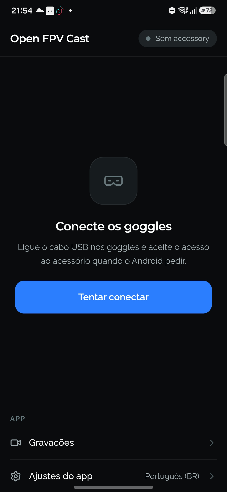
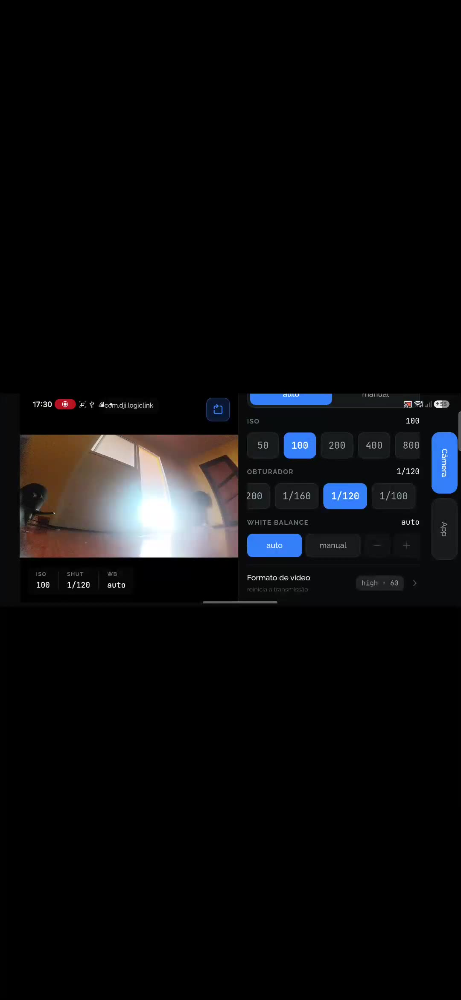

# Open FPV Cast

An open-source Android app that casts the video from **DJI FPV goggles (N3)** to your phone
over USB, lets you **record** the feed (with optional phone-mic audio), **change camera
settings**, and **re-broadcast the live view over WebRTC** so anyone on the same WiFi can watch
in a browser.

> Not affiliated with or endorsed by DJI. "DJI" and product names are trademarks of their
> respective owners and are used here only to describe hardware compatibility.

## Demo

<p align="center">
  
  &nbsp;&nbsp;&nbsp;
  
</p>
<p align="center">
  <sub>Home screen before the goggles are plugged in · the streaming layout with the camera tab open</sub>
</p>

**App tour** — connecting to the goggles, the camera state read back from the O4 Lite, auto-record,
and the switch to the landscape streaming layout:

<video src="https://github.com/1Basco/openfpvcast/raw/main/assets/app-tour.mp4" poster="https://github.com/1Basco/openfpvcast/raw/main/assets/app-tour-poster.jpg" width="280" controls muted playsinline>
  <a href="assets/app-tour.mp4">Watch the app tour (MP4)</a>
</video>

**In flight** — the goggles feed live on the phone, recording, with the side tab still reachable:

<video src="https://github.com/1Basco/openfpvcast/raw/main/assets/flight.mp4" poster="https://github.com/1Basco/openfpvcast/raw/main/assets/flight-poster.jpg" width="600" controls muted playsinline>
  <a href="assets/flight.mp4">Watch the flight clip (MP4)</a>
</video>

## How it works

The goggles expose themselves as a USB Android Open Accessory (AOA). The app opens the
accessory and speaks DJI's transport stack:

```
USB AOA  →  LogicLink (55 CC envelope)  →  DUML + camcap commands  →  H.264 Annex-B video
```

- **Video** arrives as an H.264 Annex-B byte stream on LogicLink port `0x574A` and is decoded
  with hardware MediaCodec straight to a Surface for low-latency preview.
- **Camera control** (ISO, shutter, white balance, exposure mode, video format) is sent as
  DUML `cmdSet 0x02` (camcap) commands.
- **Armed state** is read from the camera-status push the goggles emit on port `0x7530`, and drives
  auto-record. It is the *only* flight data the app parses — battery voltage, link strength and the
  rest are already drawn into the video by the goggles' own OSD, so the app doesn't duplicate them.

Every protocol constant here was established by observing the hardware — the transport, the DUML
packet layout, the camera byte maps and their confidence grades are written up in
[`AGENTS.md`](AGENTS.md).

## Features

- Low-latency live preview of the goggles feed
- Record to MP4 on the phone, with an optional phone-microphone audio track
- Auto-record when the aircraft is armed (configurable stop delay after disarm)
- Camera settings (ISO / shutter / WB / exposure mode / resolution / codec / fps), with the
  supported values verified per camera model (O4 Lite confirmed on hardware). The current
  settings are read back from the camera on connect, and changing one applies it right away
- Two UI modes: a portrait home screen when no video is flowing, and a streaming layout
  with a persistent side tab when connected — with an optional landscape lock that works even
  when the phone's auto-rotate is off
- True WebRTC broadcast to any browser on the same WiFi — the phone serves a viewer page at
  `http://<phone-ip>:8888/` (QR + copyable URL in the app; capped at 3 viewers, one hardware
  encoder each)
- English + Portuguese (pt-BR) UI; opt-in anonymous diagnostics (off by default)

> **Hardware-validation status**: connect / camera control / recording / auto-record were
> validated on real hardware (Goggles N3 + O4 Lite); the O4 Pro value ranges are being validated.
> The `armed` flag comes from the goggles' camera-status push, confirmed against live N3 captures. A raw frame/DUML viewer for further
> protocol work lives at `/debug`, and a camera value-sweep bench at `/debug/camera-matrix` (both
> behind **Settings → Developer mode**).

## Install

Grab the APK from the [latest release](https://github.com/1Basco/openfpvcast/releases/latest)
and sideload it. Each release also ships `SHA256SUMS.txt` — check your download before
installing it:

```sh
sha256sum -c SHA256SUMS.txt          # Linux  (macOS: shasum -a 256 -c)
```

```powershell
Get-FileHash .\open-fpv-cast-<version>.apk -Algorithm SHA256   # Windows, compare by eye
```

Releases are built by GitHub Actions straight from a tag on `main` — the run that produced each
artifact is linked in the release notes, and the APK is signed with the project's release key:

```sh
apksigner verify --print-certs open-fpv-cast-<version>.apk
```

## Repository layout

| Path | What |
|---|---|
| `apps/web/` | SvelteKit frontend (the app UI) — see its README |
| `plugins/capacitor-dji-aoa/` | Capacitor plugin — Kotlin USB/AOA/DUML/H.264 hardware layer |
| `android/` | Capacitor Android host project |
| `.github/workflows/` | Tag-driven release pipeline that builds and publishes the APK |
| `AGENTS.md` | Protocol reference and working rules for contributors |
| `CONTRIBUTING.md` | How to report an issue and open a pull request |

## Build

```sh
pnpm install
pnpm --filter web build     # build the SvelteKit frontend
pnpm exec cap sync android  # sync web + plugins into the Android project
pnpm exec cap run android   # build & run on a connected device
```

Requires a phone that supports USB Android Open Accessory and DJI FPV goggles (N3).

Local builds are versioned `0.0.0-dev`; the version of a shipped build comes from its release
tag. To reproduce a release build locally, pass the same values CI does:

```sh
APP_VERSION=1.2.3 pnpm --filter web build && pnpm exec cap sync android
cd android && ./gradlew -PversionName=1.2.3 -PversionCode=1002003 assembleRelease
```

## License

[MIT](LICENSE) © Open FPV Cast contributors
